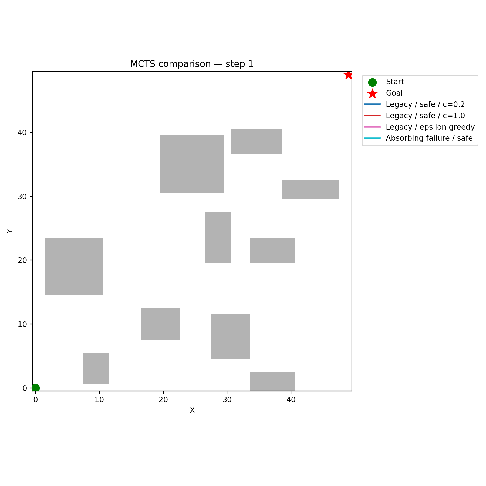

## Path Planning with Moving Obstacles

In this project, we implemented versions of A-star, Expectimax, Monte Carlo Tree Search, and Real-time Dynamic Programming in order to explore obstacle avoidance and path planning for a robot in a grid populated by dynamic obstacles. 

    

### Structure

The core logic for the simualtion is held in `grid.py`, which implements the class for the simulation as well as helper functions for generating specific grids with given properties (for instance, sparse obstacle vs dense obstacles.)

Core logic for the main functions implemented are stored in `mcts.py`, `emm.py`, `rtdp.py`, and `astar.py`, respectively. Planning algorithms using these planners inherit from the class defined in `planner.py` and operate on a grid generated by one of the helper functions in the grid file. 

### Resources Used

AI assistance was used in generating much of the code for the environment (`grid.py`) as well as the different functions for plotting the trajectories and comparing different algorithm performances. For the environment code, the initial structure and function signatures were outlined; AI was used to implement many of the smaller functions (i.e. obstacle overlap checking, etc) and was also helpful in optimizing these functions once stepping the simulation environment proved to be expensive with the initial grid implementation.

The four algorithms implemented here were implemented largely by hand in order to better understand the algorithms; while AI was used for some of the helper functions and for some code refactoring, the key program flow for these algorithms was decided by hand. We note that the implementations are not as efficient as standard, more performant implementations, but this approach was better suited to learning.

We consulted 